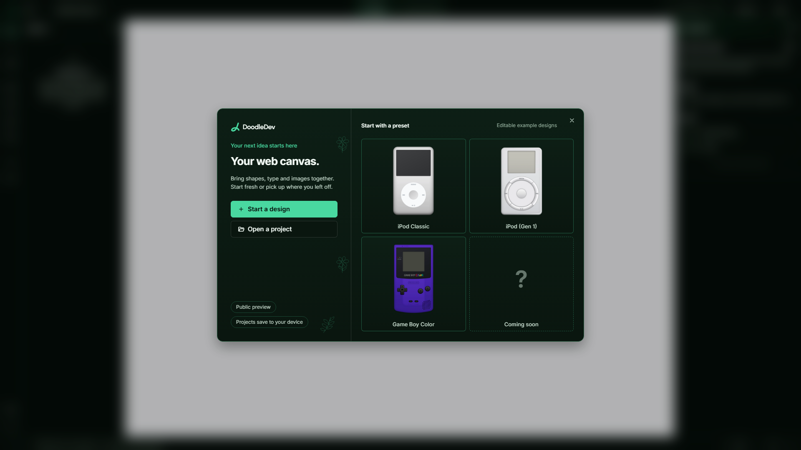
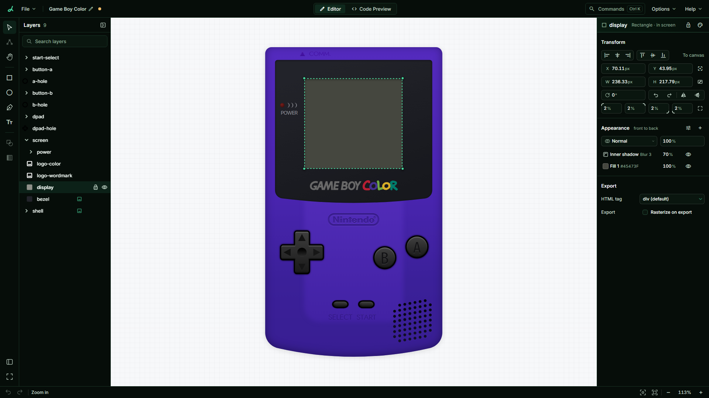
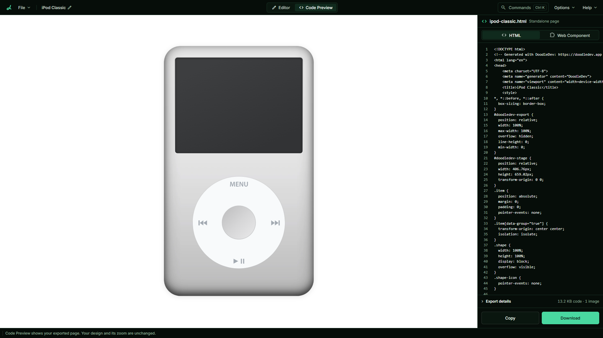

# DoodleDev

A visual design editor for the web. Draw shapes, paths, text and images on a canvas, then export your design as standalone HTML and CSS or a Web Component.

**[Explore DoodleDev](https://doodledev.app/about/) · [Open Editor](https://doodledev.app/)**

Currently in public preview. Free to use. Use a desktop browser; no account is needed.

## Features

- **Drawing tools.** Combine shapes, paths, text, icons and images on the canvas, with snap to grid.
- **Shape tools.** Build new shapes from overlapping ones, mask layers and turn strokes into outlines.
- **Type on a path.** Set text along any path.
- **Styling.** Colours, gradients and image fills.
- **Effects.** Shadow, glow, inner shadow, bevel, noise, blur, colour grade and text shadow.
- **Layers and files.** Manage layers and groups, then save a local `.doodle` file to return to later. In Chrome and Edge, Save writes back to the same file.
- **Recovery.** Unsaved work comes back if the tab closes.
- **Command palette.** Press Ctrl+K (Cmd+K on Mac) to find any command.
- **Presets.** Explore the Game Boy Color, iPod Classic and iPod (Gen 1) presets, or begin with a blank canvas.
- **Export.** Preview and download standalone HTML and CSS or a Web Component, with no framework required. Designs with images or fonts download as a ZIP.

## Get started

1. Open [doodledev.app](https://doodledev.app/) on your desktop.
2. Choose a preset or a blank canvas and start designing.
3. Select **Code Preview** to review your design, choose an export format, and download it.

Exports contain the visual design. Interactive behaviour can be added separately when you use it in a site.

This repository contains public product information. The application source is not published here.

## Learn more

- [Getting started](https://doodledev.app/getting-started/)
- [Export types](https://doodledev.app/export/)
- [Builds](https://doodledev.app/builds/)

## Related

- [iPod Classic](https://github.com/mitchivin/ipod-classic)
- [iPod Original](https://github.com/mitchivin/ipod-original)
- [Game Boy Color](https://github.com/mitchivin/game-boy-color)
- [OP-XY](https://github.com/mitchivin/te-opxy)
- [OP-1 Field](https://github.com/mitchivin/te-op1-field)
- [Frostbolt Player](https://github.com/mitchivin/frostbolt-player)
- [MitchIvin XP](https://mitchivin.com/)

## About

Built by [Mitch Ivin](https://mitchivin.com/).

Screenshots captured at 1920 × 1080.
